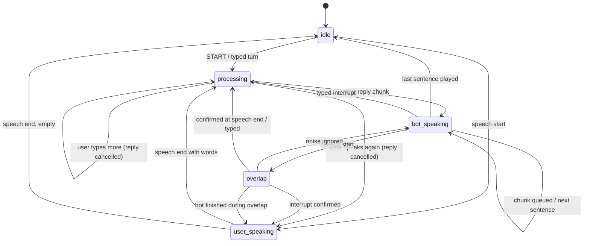

# Interrupt Lab design notes

This is the document to study before talking about the project. Read it top to bottom, then step through `src/machine.test.ts` with it open.

## The idea in one paragraph

A voice conversation is a stream of events from three independent sources: the reply generator, the speaker, and the microphone. They arrive late, out of order, and sometimes twice. Instead of reacting to each callback wherever it lands, every event goes through one pure function, `reduce(state, event)`, which returns the next state, a list of effects to perform, and a name for the transition. The browser code only translates callbacks into events and effects into API calls. All decisions live in one file and every tricky ordering is a unit test.

## State diagram



`RESET` goes from any phase back to `idle`.

## The five phases

| Phase | Meaning | Who holds the floor |
| --- | --- | --- |
| `idle` | Nobody is talking and no reply is pending. | Nobody |
| `processing` | A reply has been requested and its first chunk has not arrived. | Bot, silently |
| `bot_speaking` | The voice is playing a reply. More chunks may still be streaming in. | Bot |
| `overlap` | The user started making sound while the bot was talking. Not yet an interrupt. | Contested |
| `user_speaking` | The bot is silent and the user's words are being collected. | User |

### Why this set

- **`overlap` exists because stopping speech is not reversible.** Cancelling `speechSynthesis` throws away the rest of the utterance. If a cough stopped the bot, the only way to recover would be to say the sentence again from the start, which is its own bug. So the bot keeps talking while the reducer decides whether the sound is a real interrupt.
- **`processing` exists** so that "the user finished" and "the bot started talking" are separate moments. The gap between them is exactly where double interrupts happen, and it needs its own rules.
- **I did not add a separate "bot yielding" phase** for the time between calling `cancel()` and the voice actually stopping. The reducer treats the voice as stopped the moment it emits `stopSpeaking`, and any late voice events are rejected by the stale checks below. One fewer phase to explain, same safety.

## State fields

```ts
phase            // one of the five above
started          // true once the opener was requested or the user spoke first
nextId           // turn ids only go up, even across RESET
turns            // the transcript: bot turns and user turns, in order
activeBotId      // the bot turn being spoken (set in bot_speaking and overlap)
awaitingReplyId  // the reply we asked for (set only in processing)
utterance        // user speech in progress: { startedAt, text, gateElapsed }
```

A bot turn keeps `sentences` (everything generated), `spoken` (sentences fully played), and `heardChars` (characters played of the current sentence). **Delivered text** is the spoken sentences plus the first `heardChars` of the current one. Everything after that is **undelivered**.

A user turn keeps `startedAt` (speech start), `endedAt`, and `text`.

## Events and effects

Events come in (adapters build them, `main.ts` stamps `at`):

| Event | Source |
| --- | --- |
| `START`, `RESET` | Buttons |
| `BOT_CHUNK { turnId, text }`, `BOT_DONE { turnId }` | Streaming responder |
| `TTS_PROGRESS { turnId, index, chars }`, `TTS_END { turnId, index }` | Voice |
| `USER_SPEECH_START`, `USER_TRANSCRIPT { text }`, `USER_SPEECH_END` | Microphone |
| `NOISE_GATE_ELAPSED { speechStartedAt }` | A timer the reducer asked for |
| `USER_TYPED { text }` | Text box and Interrupt button |

Effects go out (`main.ts` performs them):

| Effect | What the app does |
| --- | --- |
| `generate { turnId, userText, history }` | Ask the responder, stream chunks back tagged with `turnId`. `userText: null` means the opener. |
| `speak { turnId, index, text }` | Play one sentence. |
| `stopSpeaking` | Cancel the voice. |
| `startNoiseGate { speechStartedAt, ms }` | Set a 300ms timer that sends `NOISE_GATE_ELAPSED`. |

The reducer never sets a timer itself. It asks for one, and the timer's event comes back through the same door as everything else. That is what lets tests fake time.

## Every transition and why it exists

Each result carries a `transition` name. These are the names you see in the event log and in the tests.

### Starting and streaming

| Transition | From → to | Why |
| --- | --- | --- |
| `opener_requested` | idle → processing | START asks for the greeting once and sets `started`. |
| `start_ignored_already_started` | stays | A second START (double click, reconnect) must not greet again. |
| `reply_started` | processing → bot_speaking | First chunk of the awaited reply creates the bot turn and speaks sentence 0. |
| `chunk_queued` | stays | A chunk arrived while a sentence is playing. Store it, speak it later. |
| `chunk_spoken` | stays | The voice was waiting for the stream. Speak the new chunk now. |
| `next_sentence` | stays | A sentence finished and another is already queued. |
| `waiting_for_next_chunk` | stays | A sentence finished but the stream has not sent more yet. |
| `stream_done` | stays | The generator is finished. The turn ends when the voice catches up. |
| `bot_turn_complete` | bot_speaking → idle | Stream done and every sentence played. |
| `tts_progress` | stays | Word boundary. Moves `heardChars` forward (never backward). |

### Overlap and interrupts

| Transition | From → to | Why |
| --- | --- | --- |
| `overlap_began` | bot_speaking → overlap | Speech started over the bot. Record `startedAt`, start the noise gate timer, keep talking. |
| `overlap_text_buffered` | stays | Words arrived before the gate. Keep them in `utterance`. |
| `noise_gate_passed_waiting_for_words` | stays | 300ms passed but the transcript is still empty. |
| `interrupt_confirmed` | overlap → user_speaking | Speech is 300ms or longer and has words. Freeze the bot turn as interrupted, stop the voice, open the user turn at `startedAt`. |
| `interrupt_confirmed_at_speech_end` | overlap → processing | Speech ended at 300ms or later with words, before the timer fired. Interrupt and close the turn in one step. |
| `noise_ignored` | overlap → bot_speaking | Speech ended too short or with no words. Drop the utterance. The bot never stopped. |
| `bot_finished_during_overlap` | overlap → user_speaking | The bot ran out of words while the user was talking. Nothing to cut, it is just their turn. |
| `typed_interrupt` | bot_speaking or overlap → processing | Typing is deliberate, so it skips the gate. Interrupt, record the text, request a reply. |

### User turns

| Transition | From → to | Why |
| --- | --- | --- |
| `user_turn_began` | idle → user_speaking | Speech with nobody else talking. |
| `user_text_updated` | stays | Recognizer sent a newer transcript for this utterance. |
| `user_turn_ended` | user_speaking → processing | Commit the words, request a reply with delivered-only history. |
| `empty_user_turn_dropped` | user_speaking → idle | Sound with no words when nobody was talking. No turn, no reply. |
| `typed_turn` | idle → processing | Typed message when nobody was talking. |
| `typed_text_added` | stays | Typed while also speaking. Added to the open turn. |
| `reply_cancelled_user_resumed` | processing → user_speaking | User spoke again before the reply arrived. Forget that reply, reopen their turn. |
| `reply_cancelled_user_typed_more` | processing → processing | Same, but typed. Merge and request one new reply. |

### Rejections (state unchanged)

| Transition | Why |
| --- | --- |
| `stale_chunk_dropped`, `stale_done_dropped` | Chunk for a reply that was cancelled or belongs to an interrupted turn. |
| `stale_tts_dropped` | Voice event for a turn that is no longer active, or for a sentence index that already moved on. |
| `stale_noise_gate_ignored` | Timer from an earlier utterance, or we already left overlap. |
| `duplicate_speech_start_ignored` | Second speech start while one is already open. |
| `transcript_without_speech_ignored`, `speech_end_ignored` | Recognizer events with no utterance open. |
| `empty_text_ignored` | Blank typed text. |
| `reset` | Clear the conversation, stop the voice, keep counting ids. |

## The edge cases

Each has a `describe('edge case: ...')` block in `machine.test.ts`.

### 1. Speech during the bot to user handoff is buffered, not dropped

**The bug:** a naive app only records transcripts once it has switched to "user is speaking". Words recognized during the overlap, usually the most important ones like "wait" or "no", are thrown away. The saved turn reads "tell me a joke" instead of "wait, tell me a joke".

**The fix:** `utterance` exists in `overlap` too. Every `USER_TRANSCRIPT` updates it whatever the phase. When the interrupt is confirmed, the same utterance becomes the user turn. If the bot finishes during overlap, the utterance is promoted instead of lost (`bot_finished_during_overlap`). When the user speaks again during `processing`, their previous turn is reopened and the new words are appended.

### 2. The truncated bot turn is saved as delivered text only

**The bug:** saving the full generated reply. The next reply is then based on sentences the user never heard ("as I said, the second option...").

**The fix:** the bot turn tracks `spoken` and `heardChars` from the voice's own progress events and freezes them at the interrupt. `history()` uses `deliveredText()` for bot turns, and that history is what `generate` sends to the responder. Ask "what did you just say" in the app to see it.

**A related bug the test also covers:** calling `speechSynthesis.cancel()` fires a late end (or error) event for the sentence that was cut. If the app handled it normally, it would mark that sentence as fully spoken, or start speaking the next one. The turn is no longer active, so `TTS_END` is dropped as stale.

**Honest limit:** if a voice sends no word boundary events, `heardChars` stays 0 and the partial sentence counts as unheard. I chose to under-report, because claiming the user heard something they did not is worse than repeating a few words.

### 3. The opener is never replayed after an interrupt

**The bug:** "resume after interrupt" logic that retries the unfinished bot turn. When that turn is the greeting, the bot says "Hi, I'm..." again. It also happens when a second START fires.

**The fix:** the machine never retries a turn. It always asks for a fresh reply to what the user said. The opener is only requested from `START`, and only while `started` is false. `started` also becomes true when the user speaks first, so a late START cannot greet mid-conversation. Late opener chunks are stale and dropped.

### 4. The interrupt timestamp comes from speech start

**The bug:** stamping the user turn when recognition finishes, often a second or two after the user began talking. The transcript then shows the user speaking after the bot finished, turns sort out of order, and latency numbers are wrong.

**The fix:** `USER_SPEECH_START` records `utterance.startedAt`, and that becomes the user turn's `startedAt` no matter which later event confirms the interrupt. The bot turn separately records `stoppedAt`, the moment we were sure. The difference is the reaction latency shown in the app (about 300ms, the gate). The tests fake both events at different times and check which one is used.

The mic adapter runs one recognition session per utterance for this reason: in continuous mode one session spans many utterances, so `speechstart` does not reliably mark the start of each one.

### 5. Rapid double interrupts do not corrupt state

**The bug:** two interrupts close together (typing then talking, or a double click) produce two user turns, two replies speaking over each other, or a reply to only the first half.

**The fix, in three parts:**
- Every reply has a `turnId`. Only the reply in `awaitingReplyId` or the turn in `activeBotId` is accepted. Everything else is stale. Cancelling a reply is just clearing `awaitingReplyId`. The responder's timers keep running on purpose, and the reducer drops their output.
- If the bot has not spoken since the user's last turn, new input reopens that turn instead of creating a second one (`openUserTurn`). One turn, one reply.
- Duplicate speech starts are ignored, and the noise gate event carries `speechStartedAt`, so an old timer cannot confirm a newer utterance.

`RESET` keeps `nextId` counting for the same reason. If ids restarted at 1, a late chunk from the old conversation could match the new opener.

### 6. Short noise does not count as an interrupt

**The bug:** a cough, a keyboard click, or a breath stops the bot mid-word.

**The fix:** an utterance is real speech only if it has lasted at least 300ms **and** has a non-empty transcript (`isRealSpeech`). "Lasted" is true if the gate timer fired or if the current event is 300ms or more after the start. The second check covers the race where speech ends before the timer's callback runs. Noise sends the machine back to `bot_speaking`, and because we never stopped the voice, there is nothing to recover.

**Tradeoff:** a short, real "no" under 300ms is ignored. A real product would tune this per user or use a proper voice activity detector.

## Why the reducer is pure

1. **Testable without a browser.** Speech APIs cannot run in CI, and even in a browser their timing is not repeatable. Pure events in, plain data out: every test is a list of events and some `expect`s. 24 tests run in milliseconds.
2. **Orderings are explicit.** The hard bugs here are about "what if B arrives before A". With a reducer I can write that order down directly. With callbacks scattered through the UI, it is hidden in timing.
3. **One place for every decision.** Adapters are thin enough to read in a minute. If behavior is wrong, the cause is in `machine.ts` or the event log shows the adapter sent the wrong event.
4. **Replayable.** The scripted scenarios are just timed events. A logged sequence from a real bug could be pasted into a test the same way. This is the same idea as replaying scripted calls in CI.
5. **No hidden time.** The reducer never calls `Date.now()` or `setTimeout`. Time arrives as `at` on events, and timers are effects.

`main.ts` adds one piece of plumbing: events sent while another event is being handled are queued, because the silent voice sends its first progress event synchronously from inside `speak`. The reducer always sees one event at a time in the order they were sent.

## Walkthrough: one interrupt, event by event

Run "Interrupt mid-sentence" and follow the log.

1. `START` → `opener_requested`, phase processing, effect `generate(1, null)`.
2. `BOT_CHUNK turn 1` → `reply_started`, phase bot_speaking, effect `speak(1, 0)`. More chunks → `chunk_queued`.
3. `TTS_END turn 1 sentence 0` → `next_sentence`, effect `speak(1, 1)`.
4. `USER_SPEECH_START` at 3.6s → `overlap_began`, effect `startNoiseGate(3600, 300)`. Bot keeps talking.
5. `USER_TRANSCRIPT "wait"` at 3.75s → `overlap_text_buffered`. Only 150ms, not yet real.
6. `NOISE_GATE_ELAPSED` at 3.9s → `interrupt_confirmed`. Bot turn frozen with its heard characters, `stoppedAt` 3.9s, effect `stopSpeaking`. User turn opens with `startedAt` 3.6s and the buffered "wait".
7. `USER_TRANSCRIPT "wait, tell me a joke"` → `user_text_updated`.
8. `USER_SPEECH_END` → `user_turn_ended`, phase processing, effect `generate(3, "wait, tell me a joke", history)` where the bot's entry is only the delivered text.
9. Reply chunks for turn 3 → `reply_started`, and so on to `bot_turn_complete`.

## Known limitations

- **Echo.** Without headphones the mic hears the bot and interrupts it. Browser speech recognition opens the mic itself, so the page cannot feed it an echo cancelled stream. A real system would use acoustic echo cancellation on a `getUserMedia` stream or compare transcripts against what the bot is saying.
- **Browser recognition is a black box.** Its speech start and end timing is coarse and it only exists in Chrome and Edge.
- **A cough during `processing` cancels the pending reply.** The user turn is reopened and then closed with the same text, so a new reply is requested. Nothing is lost, but it costs a regeneration. A noise gate in `processing` would fix it.
- **Word level progress depends on the voice** sending boundary events (see edge case 2).

## What I would do next

1. **Real LLM streaming.** Replace `responder.ts` with a streamed API call. Split tokens into sentences as they arrive and send `BOT_CHUNK`s. Cancelling would also abort the HTTP request, while the reducer's stale id check stays as the safety net.
2. **VAD instead of browser recognition.** Run a voice activity detector (for example a small WebAssembly model on an `AudioWorklet`) for accurate speech start and end, and send audio to a streaming speech-to-text service for transcripts. The reducer would not change: it already separates "speech started" from "words arrived".
3. **Latency metrics.** Record speech start to voice stop (already shown), user speech end to first reply chunk, and first chunk to first audio. Log them per turn and show p50 and p95.
4. **Smarter barge-in.** Duck the bot's volume during overlap instead of talking at full volume, and treat backchannels like "mm-hm" as non-interrupts.
5. **Replay tests from real sessions.** Export the event log as JSON and load it as a test fixture, so any bug seen in the app becomes a regression test.
6. **Property based tests.** Generate random event sequences and check invariants, for example: `awaitingReplyId` is set only in `processing`, at most one bot turn is live, and delivered text is always a prefix of the generated text.

## Likely questions, short answers

- **Why not XState?** The machine is five phases and fits in one file. A plain reducer is easier to read line by line, has no library semantics to explain, and is trivially testable. If it grew parallel or nested states, I would reconsider.
- **Why is the transition a string?** It is for humans: the event log and test assertions. Behavior never branches on it.
- **What happens if chunks arrive out of order?** Chunks for the same turn come from one stream, which is ordered. Chunks from different turns can interleave, and the id check handles that. If a real transport could reorder within a turn, I would add a sequence number to `BOT_CHUNK`.
